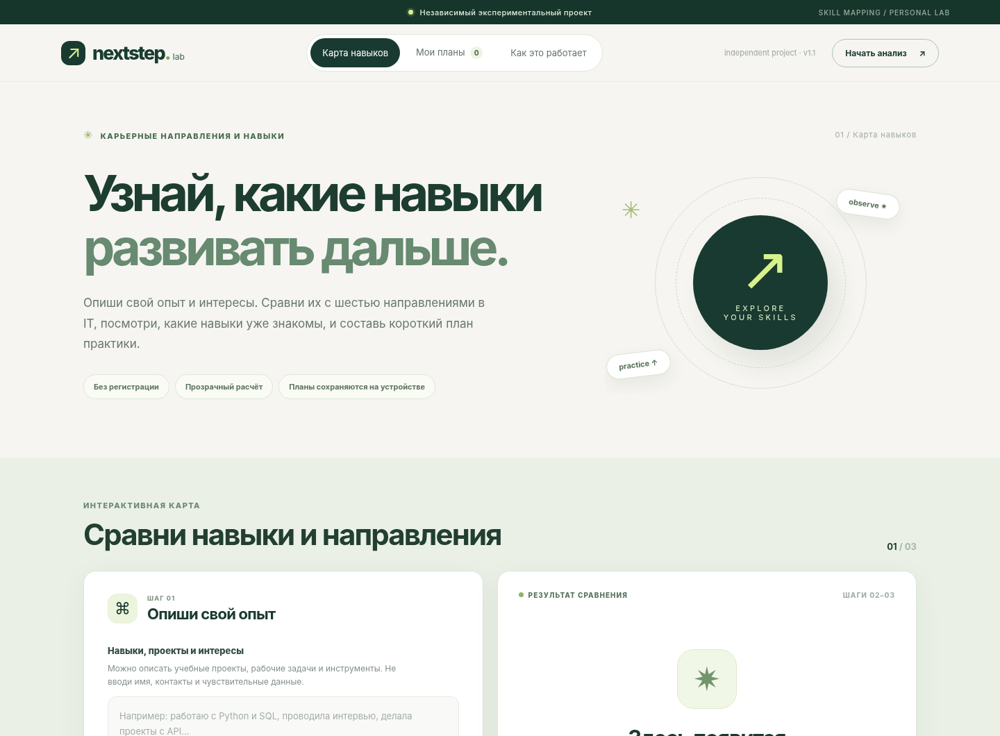

# NextStep Lab

**Интерактивная карта навыков и персональные планы практики по IT-направлениям.**

Экспериментальный веб-проект, в котором я исследую, как превратить свободное описание опыта в понятное сравнение навыков и конкретные следующие шаги. Проект задуман как небольшой MVP: от пользовательского ввода до сохранённого плана, к которому можно возвращаться.

**[Открыть демо](https://nextstep-career-lab.vercel.app/)** · [Посмотреть код](https://github.com/norightt/nextstep-career-lab)



## Что решает проект

Когда человек изучает новую профессиональную область, бывает сложно связать уже имеющийся опыт с требованиями выбранного направления. NextStep Lab помогает структурировать исходную информацию, увидеть пересечения с демонстрационными наборами компетенций и выбрать небольшие практические упражнения на две недели.

**Это учебная карта навыков, а не система оценки кандидатов.** Сравнение выполняется с шестью специально составленными профилями, а не с реальными вакансиями. Проценты отражают покрытие навыков внутри модели, не вероятность трудоустройства и не профессиональную пригодность.

## Пользовательский сценарий

1. Пользователь свободным текстом описывает навыки, опыт и интересы (или выбирает пример).
2. Приложение распознаёт упомянутые навыки по словарю русских и английских выражений.
3. Сравнивает их с шестью учебными направлениями и объясняет результаты: какие навыки распознаны, какие пока не указаны.
4. Предлагает практические задания и вопросы для самооценки на 14 дней.
5. Позволяет сохранить несколько планов в браузере, отмечать выполнение задач и экспортировать данные.

Направления: **аналитика данных, продуктовая аналитика, системный анализ, UX-исследования, разработка AI-приложений, продуктовый менеджмент.**

## Как устроен MVP

| Компонент | Реализация |
| --- | --- |
| Интерфейс | HTML, CSS, JavaScript (ES modules); адаптивная вёрстка |
| Анализ текста | Словарное распознавание навыков с защитой от части ложных совпадений коротких сокращений |
| Сопоставление | Объяснимый rule-based алгоритм и учебные веса компетенций |
| Персональный план | Набор практических упражнений и вопросов, связанных с направлением |
| Сохранение | `localStorage`; экспорт TXT/JSON, без регистрации и облачной базы |
| Дополнительный LLM-режим | Опциональная Vercel Function `/api/coach` с OpenAI API; требует серверной настройки ключа и кода доступа |

**Почему rule-based подход в основе:** для первого прототипа важно получать воспроизводимые и проверяемые результаты без внешнего API. LLM-персонализация вынесена в отдельный опциональный режим: без её подключения основной пользовательский сценарий полностью работает.

### Использование AI в разработке

Проект создан в формате **AI-assisted development**. ChatGPT использовался для проработки структуры MVP, генерации и доработки HTML/CSS/JavaScript, уточнения логики, подготовки тестов и разбора ошибок при публикации. Проверка пользовательских сценариев и публикация проекта выполнялись с использованием GitHub и Vercel. Эти сервисы используются для хранения кода и деплоя, а не как генеративные AI-инструменты.

## Запуск локально

Для основного интерфейса достаточно Python 3; установка дополнительных зависимостей не требуется.

```bash
python3 -m http.server 8000
```

На Windows:

```powershell
py -m http.server 8000
```

После запуска открой [http://localhost:8000](http://localhost:8000). Запускать команду нужно в папке с `index.html`.

**Проверка сценария:** «Подставить пример» → «Сравнить направления» → выбрать направление → «Сохранить план» → «Мои планы» → отметить задание.

### Тесты

Нужен Node.js 18+:

```bash
npm test
```

Шесть тестов покрывают обнаружение навыков на русском и английском, ложные совпадения сокращений, корректность результатов сравнения, создание плана и ограничения длины ввода. Файл тестов: [`tests/engine.test.mjs`](tests/engine.test.mjs).

## Структура

```text
index.html               Страницы и разметка
styles.css               Адаптивные стили
app.mjs                  Поведение интерфейса, localStorage, экспорт
engine.mjs               Извлечение навыков и расчёт рекомендаций
data.mjs                 Учебные направления и словари компетенций
api/coach.js             Необязательная серверная LLM-функция
tests/engine.test.mjs    Автоматические тесты
assets/                  Скриншоты интерфейса
vercel.json              Конфигурация Vercel
.env.example             Пример названий серверных переменных без секретов
```

Подробности деплоя: [DEPLOY_GUIDE.md](DEPLOY_GUIDE.md). Архитектурные и исследовательские заметки: [PROJECT_NOTES.md](PROJECT_NOTES.md).

## Ограничения и дальнейшие шаги

- Словарь может пропускать синонимы и не всегда отличает упоминание навыка от подтверждённого владения им.
- Профили и веса демонстрационные: для их улучшения потребуются интервью с пользователями и дополнительные данные.
- Планы сохраняются в конкретном браузере; синхронизации между устройствами нет.
- Основной анализ выполняется локально. Если включить отдельный LLM-режим, текст профиля будет отправляться через серверную функцию внешнему AI-провайдеру; персональные данные в поле ввода указывать не следует.
- Гипотеза о полезности продукта пока не проверялась на реальных пользователях. Следующим шагом могут стать качественные интервью и измерение доли пользователей, сохраняющих план и возвращающихся к нему.

**Статус:** работающий экспериментальный MVP, не коммерческий продукт и не инструмент для принятия кадровых решений.
